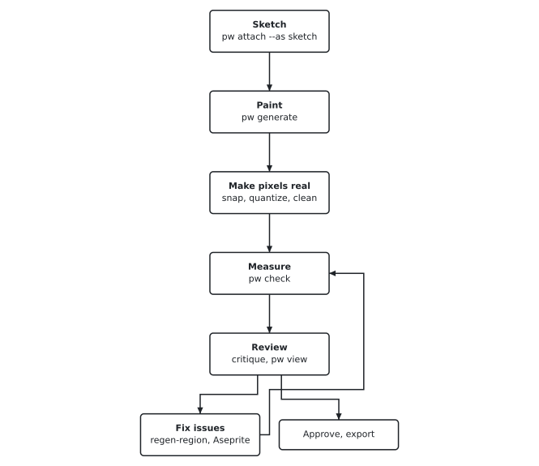

# How pixelwright works

pixelwright turns a sketch into game-ready pixel art. Image models paint; code makes the
pixels real and measures them; Claude reviews like an art director; you decide.

Try it first, offline and free: `pw tour` runs every step below on a sample in a few
seconds and explains each one.

## The loop

 <!-- drawspec-render -->

<details><summary>Diagram source</summary>

```drawspec
{"version": 1, "kind": "flow", "title": "One asset, from sketch to export",
 "nodes": [
  {"id": "S", "text": "Sketch\npw attach --as sketch"},
  {"id": "G", "text": "Paint\npw generate"},
  {"id": "P", "text": "Make pixels real\nsnap, quantize, clean"},
  {"id": "C", "text": "Measure\npw check"},
  {"id": "R", "text": "Review\ncritique, pw view"},
  {"id": "F", "text": "Fix issues\nregen-region, Aseprite"},
  {"id": "A", "text": "Approve, export"}
 ],
 "edges": [
  {"from": "S", "to": "G"}, {"from": "G", "to": "P"}, {"from": "P", "to": "C"},
  {"from": "C", "to": "R"}, {"from": "R", "to": "F"}, {"from": "F", "to": "C"},
  {"from": "R", "to": "A"}
 ]}
```

</details>

1. **Sketch.** You draw the composition; `pw attach <id> sketch.png --as sketch`.
2. **Paint.** `pw generate <id> --prompt "..."` asks an image model for 1-4 candidates.
   They look like pixel art, but their pixels are fake (soft edges, noise, uneven grid).
3. **Make the pixels real.** `pw snap` finds the grid and shrinks to true pixels,
   `pw quantize` maps colours to the palette, `pw clean` removes stray pixels.
4. **Measure.** `pw check` runs the rules a machine can measure and marks where they fail.
5. **Review.** Claude writes a critique against the style guide; you look in `pw view`
   and mark what is wrong as issues.
6. **Fix.** Each issue is a region: repaint it (`pw regen-region`), redo a step inside it
   (`pw quantize --mask`), or retouch it in Aseprite. Then measure again.
7. **Approve and export.** `pw approve <id> <version>`, then `pw export <id>`.

Lost? `pw next <id>` names the next step for an asset and why; the viewer shows the same
hint under the image.

## Glossary

| Word | Meaning |
|---|---|
| asset | one game image (a background, a sprite), a folder under `assets/` |
| version | one image of an asset (`v0001`, `v0002`...); every step makes a new one, nothing is overwritten |
| stage | where a version stands: draft, approved, rejected, final (exported) |
| check | an automatic measurement against a rule (palette, orphan pixels, banding, contrast) |
| critique | Claude's written review of a version, one section per complaint |
| issue | a region of a version that needs fixing, drawn by you or found by a check or critique |
| style guide | `style/`: palette, rules and references every asset follows |
| provider | the image model that paints: `replay` (offline), `comfyui` (local GPU) or a paid API |

## Your first real asset

1. `pw init my-game --canvas 320x180` and `cd my-game`.
2. `pw doctor` shows what is set up (ComfyUI, keys, Aseprite) and how to fix the rest.
3. `pw new title-bg --kind background`, then `pw attach title-bg sketch.png --as sketch`.
4. Follow `pw next title-bg` until it says done. With Claude, ask it to "run the review
   loop": it drives the same commands and asks you only to look and decide.

Local painting on your GPU: [comfyui.md](comfyui.md). Spending is capped per month
(`pw cost` shows it); paid providers need a key in `.pixelwright/secrets.toml`.
