# pixelwright — Screens (annotated edition)

> Generated 2026-11-16. This is the document with a **note slot** after every section that has text of its own. Read it in any Markdown app. To annotate, replace the `_(your notes…)_` placeholder under any section. When done, send the file back — notes are acted on.

---

# Screens

## Preamble & scope

**Revision**: 2
**Status**: draft
**Revision log**:
- r2 — applied `pixelwright-screens-v1-2026-11-16-1748-notes.md` (8 notes + thread question): no logo yet, shorter start screen, Open… takes a folder or any image in a project, author legend and author names, request box says where it goes, fit/zoom/pan with linked before/after, Mark an area moved into the request box, group ⋯ and Asset settings for overrides, sort order, advice history

The screens of the new app (spec §2.2, plan T52), drawn as a static mockup (`status/screens/mockup.html`,
`#s01` … `#s10`, add `,dark` for dark mode) before anything is built. The art is a placeholder.

<!-- -->

> **✎ Notes** · `SCREENS · intro`
> _(your notes here — replace this line)_

## S00 · Ground rules for every screen

- **Two places only**: a project (its assets) and one asset. Settings and the start screen sit outside the flow.
- **Who is next is always visible.** Every asset says its next step and who does it: you (orange), the AI (teal) or the scripts (amber). Advice, versions and markers use the same three colours.
- **The AI status is always in the top bar**: "AI listening" when a session is waiting with `pw wait`, otherwise "No AI session: requests wait".
- **No modes.** The asset screen has one view of the image, with a Before / after switch; marking an area is a button, not a mode.
- **Authors are named, not only coloured**: a legend in the top bar, and each piece of advice starts with Scripts, AI or You.
- **The logo is a placeholder** (wordmark only) until the logo task.
- Pixels only in the image; soft chrome; light and dark themes.

<!-- -->

> **✎ Notes** · `SCREENS › S00 · Ground rules for every screen`
> _(your notes here — replace this line)_

## S01 · Start

Shown when no project is open: one sentence and three ways in. A project is a folder; **Open…** accepts the folder or any image inside it (pixelwright finds the nearest `pixelwright.toml` and opens that asset). The sample project starts the guided first run.

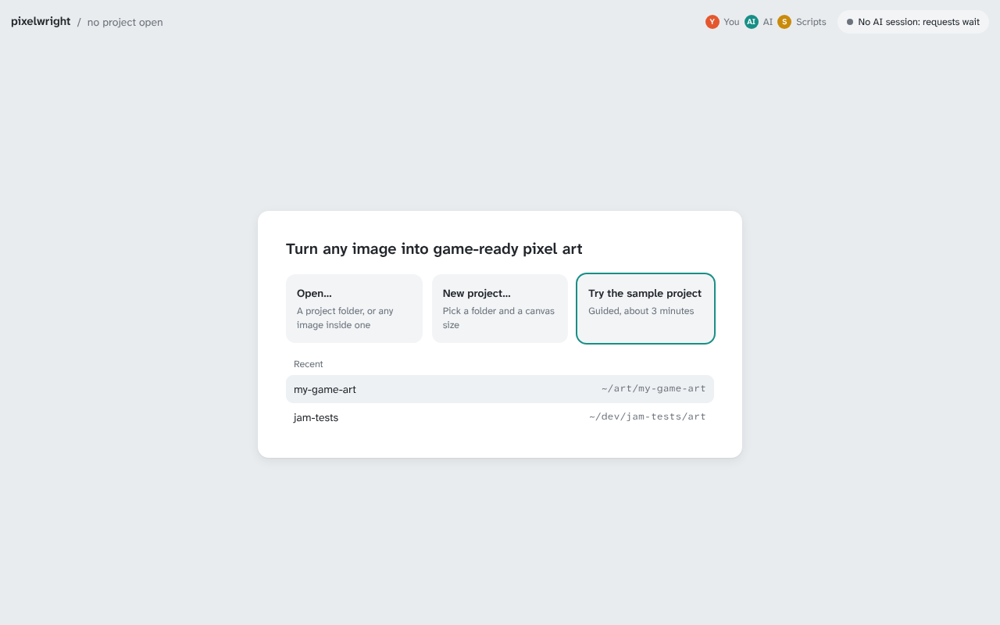

<!-- -->

> **✎ Notes** · `SCREENS › S01 · Start`
> _(your notes here — replace this line)_

## S02 · Project

All the assets of a project, by group (sub-folders). Each card shows its state and its single next step with the actor. "Waiting on" counts what each actor owes. Dropping an image anywhere creates an asset (flow step 1). **Order**: assets waiting on you first, then by last change; the Sort menu also offers name. A group's ⋯ menu sets its defaults (canvas size, palette).

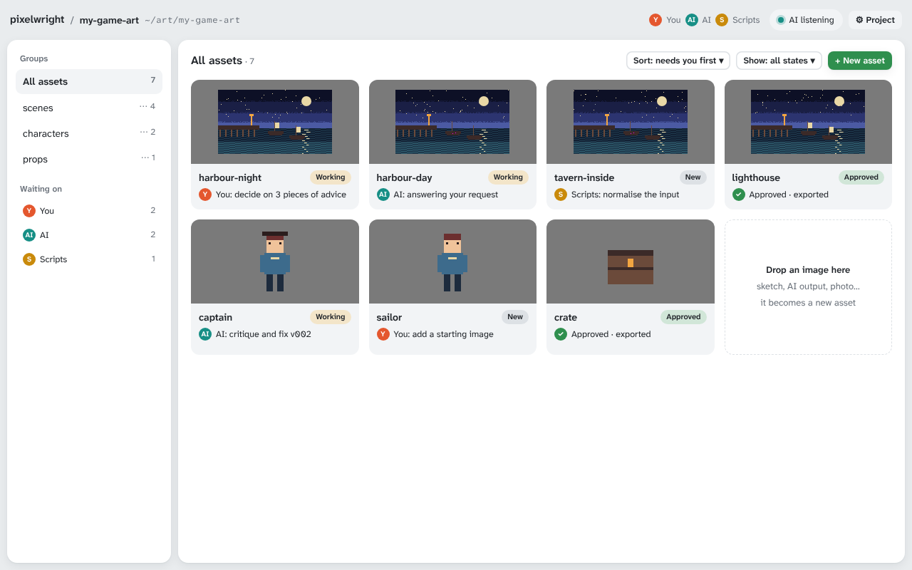

<!-- -->

> **✎ Notes** · `SCREENS › S02 · Project`
> _(your notes here — replace this line)_

## S03 · Asset

The image in the centre with numbered advice markers; the versions strip below (input → v001 …, author of each, ★ = starred); advice on the right with Accept / Reject… / Show. **Pending advice stays on top; accepted and rejected advice folds into History** at the bottom. Below it: the request box and the one final action, Approve and export (step 6). The image fits the window; scroll zooms, drag moves, zoom sits bottom right.

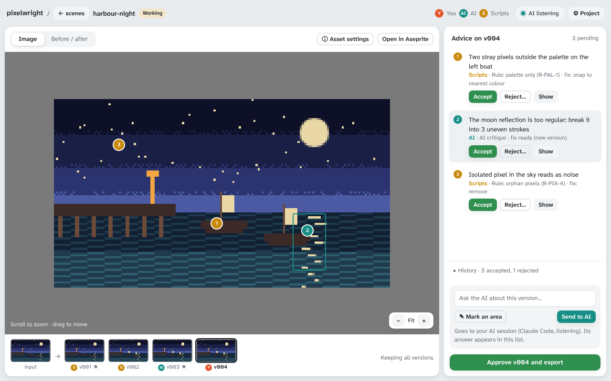

<!-- -->

> **✎ Notes** · `SCREENS › S03 · Asset`
> _(your notes here — replace this line)_

## S04 · Rejecting advice

Reject asks why. The reason can become a style rule for this asset, its group or the whole project, so the same advice is not given again.

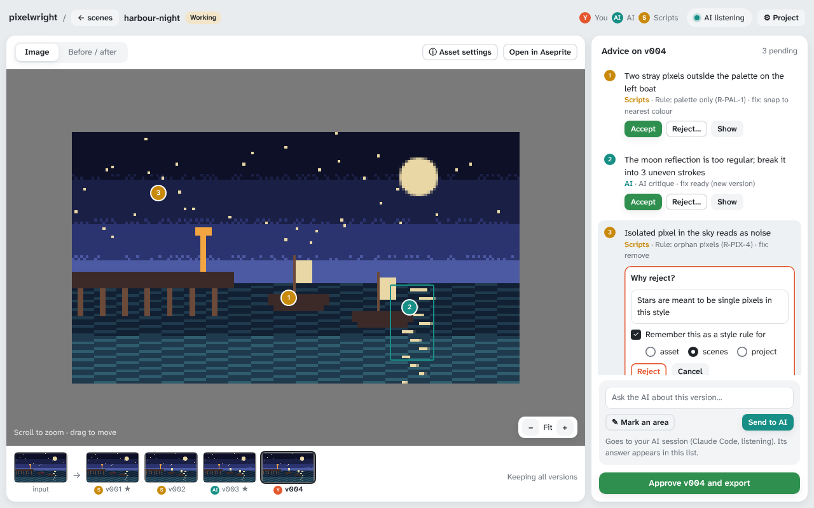

<!-- -->

> **✎ Notes** · `SCREENS › S04 · Rejecting advice`
> _(your notes here — replace this line)_

## S05 · A request to the AI

The conversation with the AI stays in its own session (Claude Code or Desktop). The app only leaves a request: you mark an area (dashed) and send. A session that is listening (`pw wait`) wakes, works on it, and its answer arrives here as new advice or a new version; the request shows when it was picked up. With no session listening, it waits.

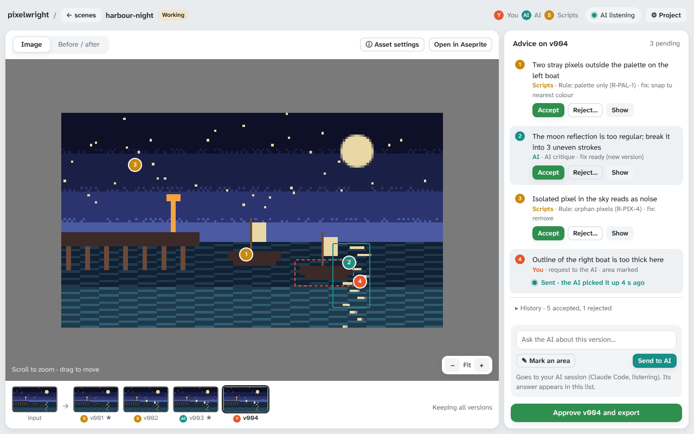

<!-- -->

> **✎ Notes** · `SCREENS › S05 · A request to the AI`
> _(your notes here — replace this line)_

## S06 · Before / after

The previous and the current version side by side. Both start fitted; zoom and drag are linked, so both sides always show the same area.

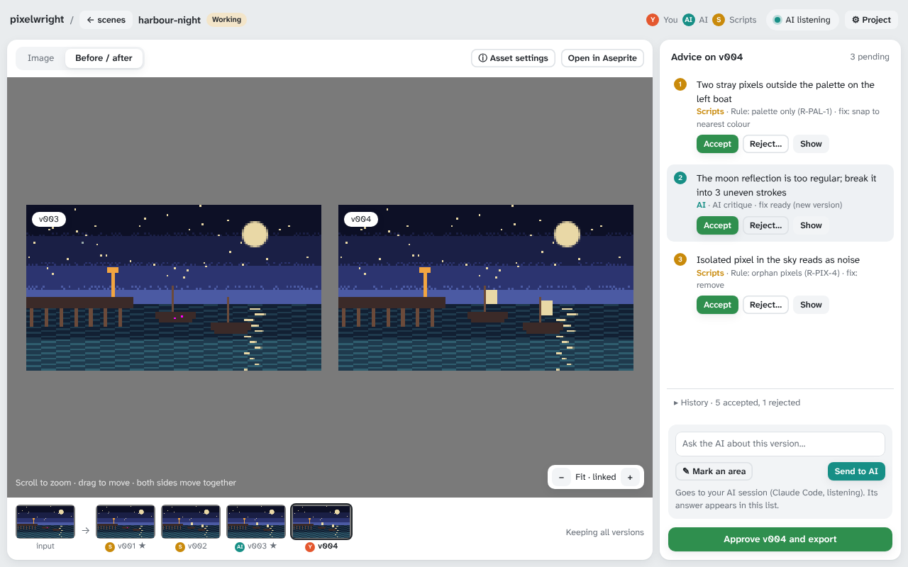

<!-- -->

> **✎ Notes** · `SCREENS › S06 · Before / after`
> _(your notes here — replace this line)_

## S07 · Project settings

Palette library (groups set a default), default canvas, export path (can point into the game engine's project), "Keep all versions" (on by default), and the style rules, including the ones learnt from rejections. The canvas here is the project default; a group overrides it from its ⋯ menu and an asset from ⓘ Asset settings.

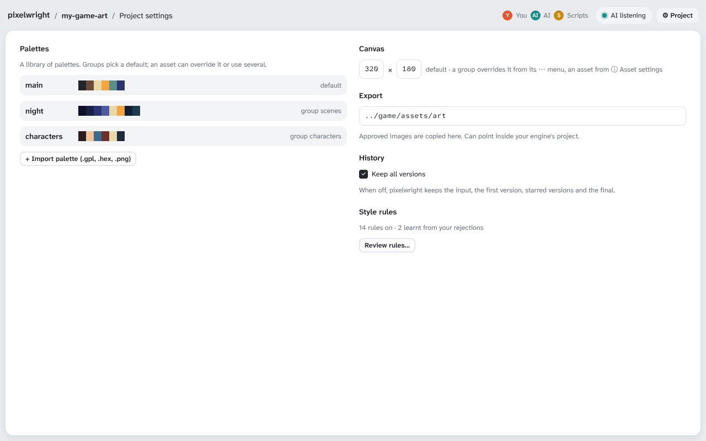

<!-- -->

> **✎ Notes** · `SCREENS › S07 · Project settings`
> _(your notes here — replace this line)_

## S08 · First run, step 1

The sample project opens with a short guide (6 steps) that points at the real screen instead of a help page.

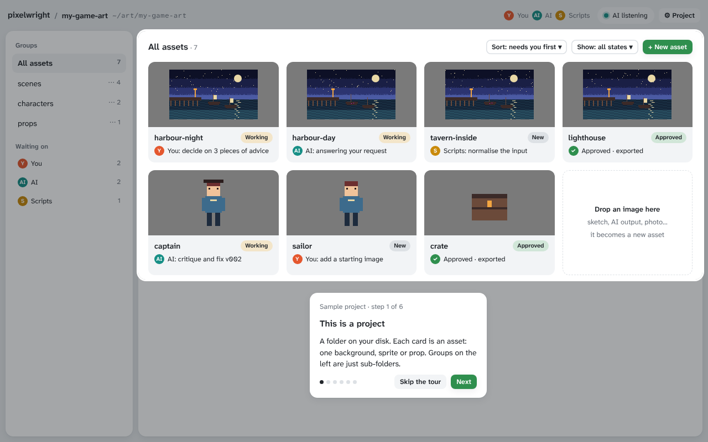

<!-- -->

> **✎ Notes** · `SCREENS › S08 · First run, step 1`
> _(your notes here — replace this line)_

## S09 · First run, step 2

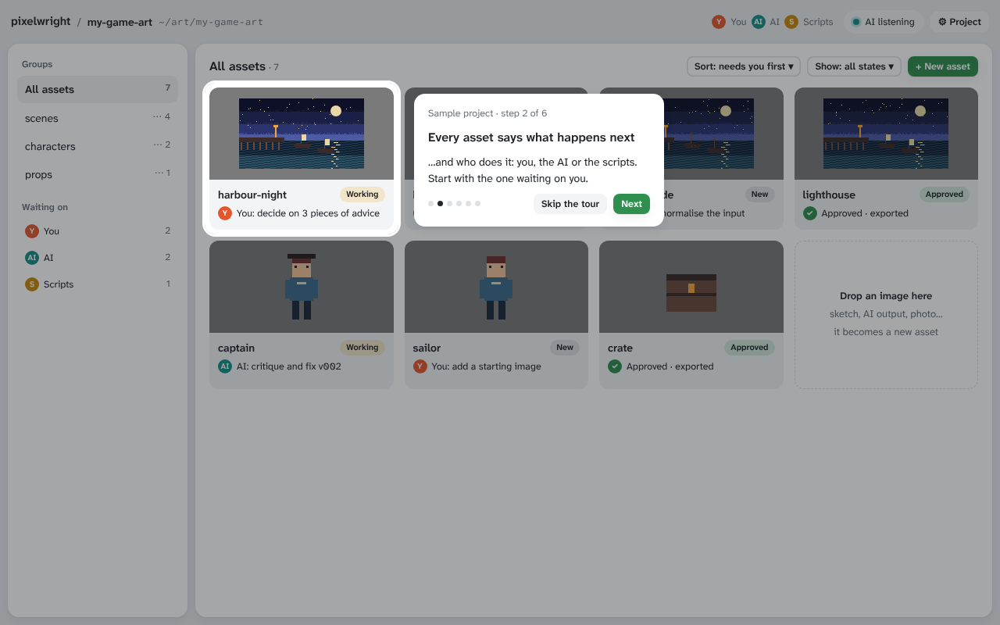

<!-- -->

> **✎ Notes** · `SCREENS › S09 · First run, step 2`
> _(your notes here — replace this line)_

## S10 · First run, step 3

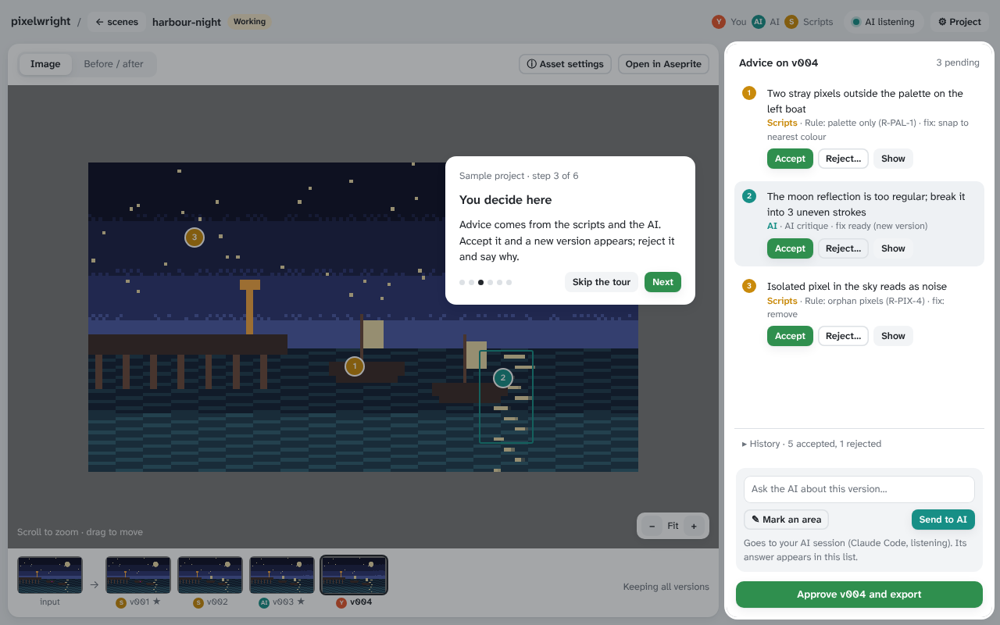

<!-- -->

> **✎ Notes** · `SCREENS › S10 · First run, step 3`
> _(your notes here — replace this line)_

## S11 · Dark theme

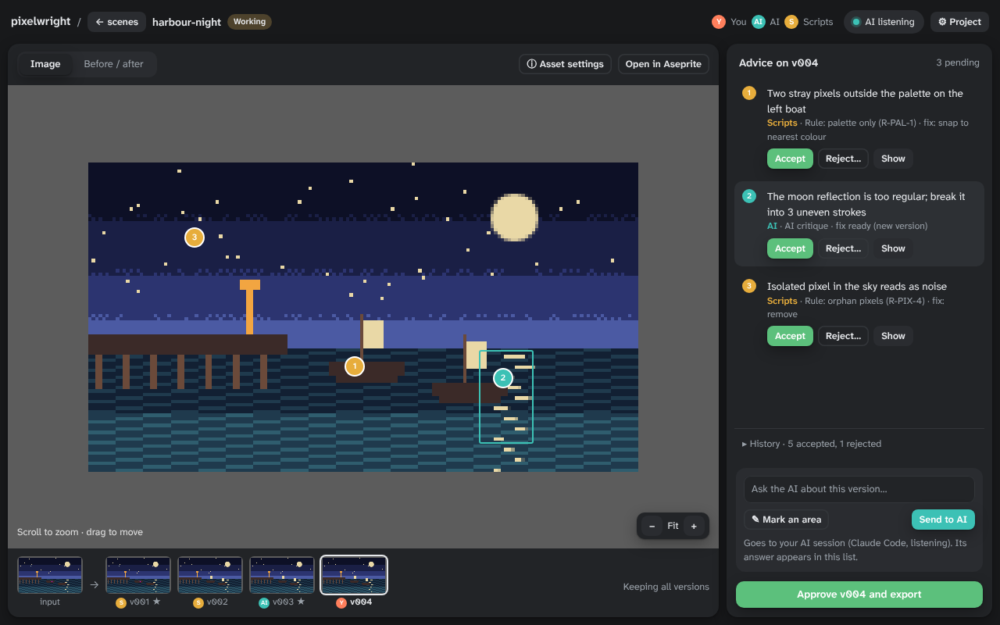

<!-- -->

> **✎ Notes** · `SCREENS › S11 · Dark theme`
> _(your notes here — replace this line)_

