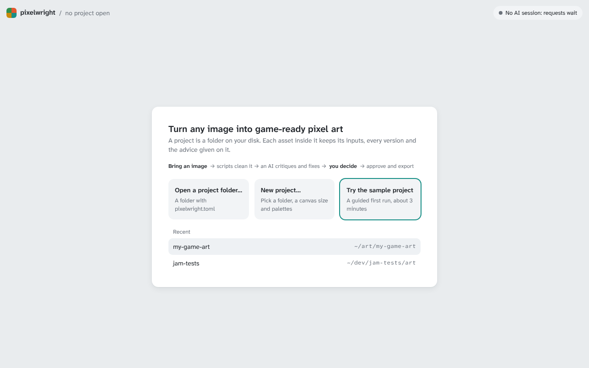
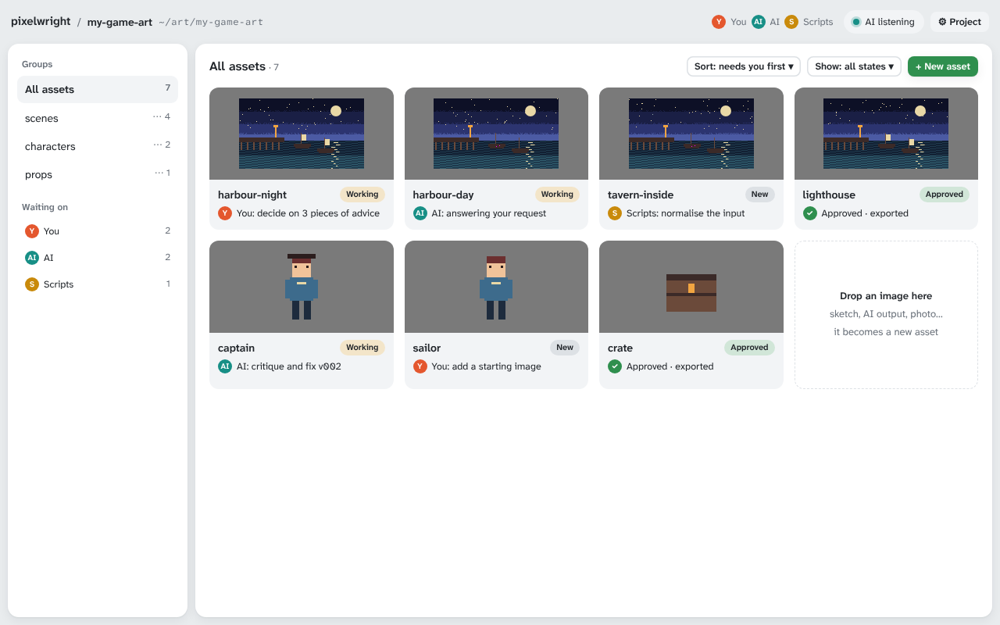
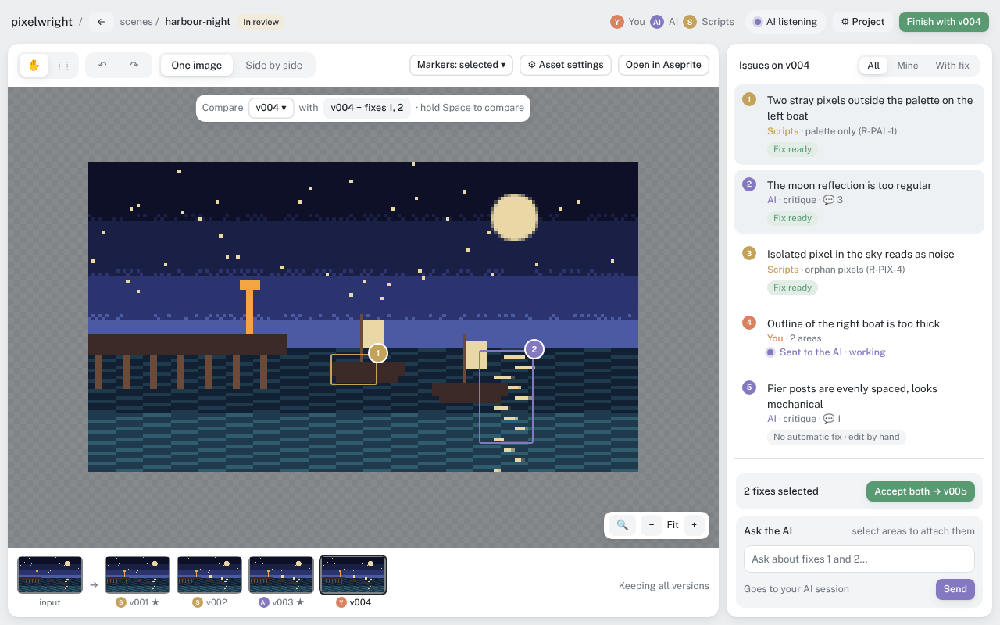
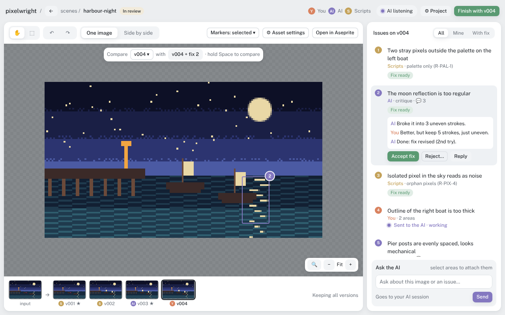
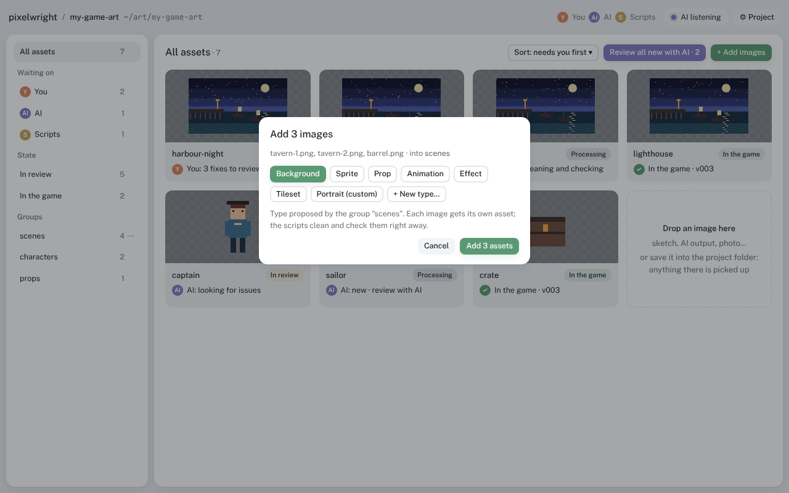
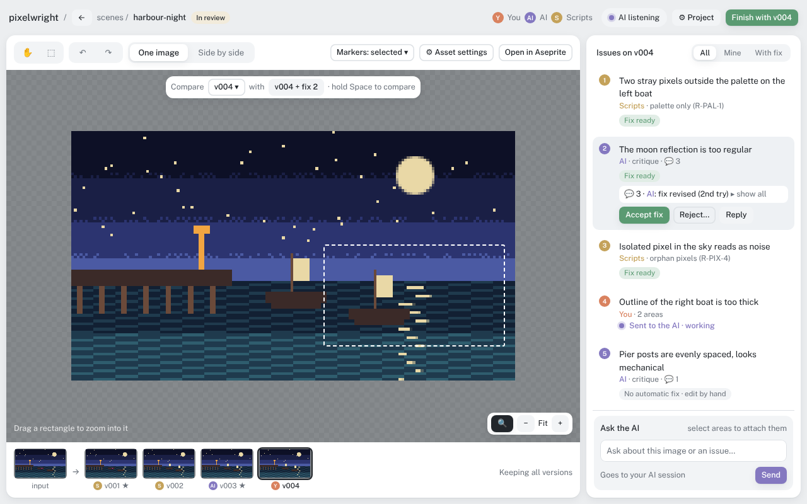
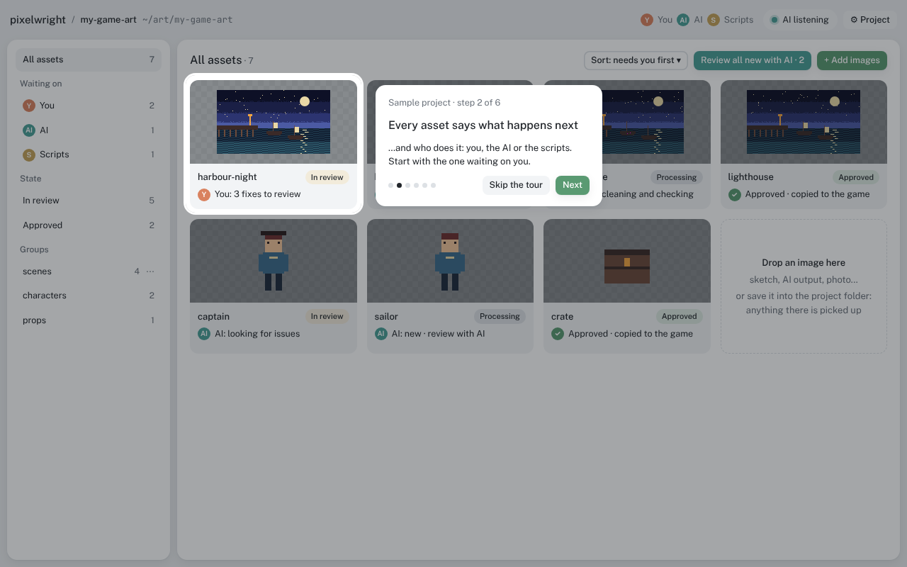
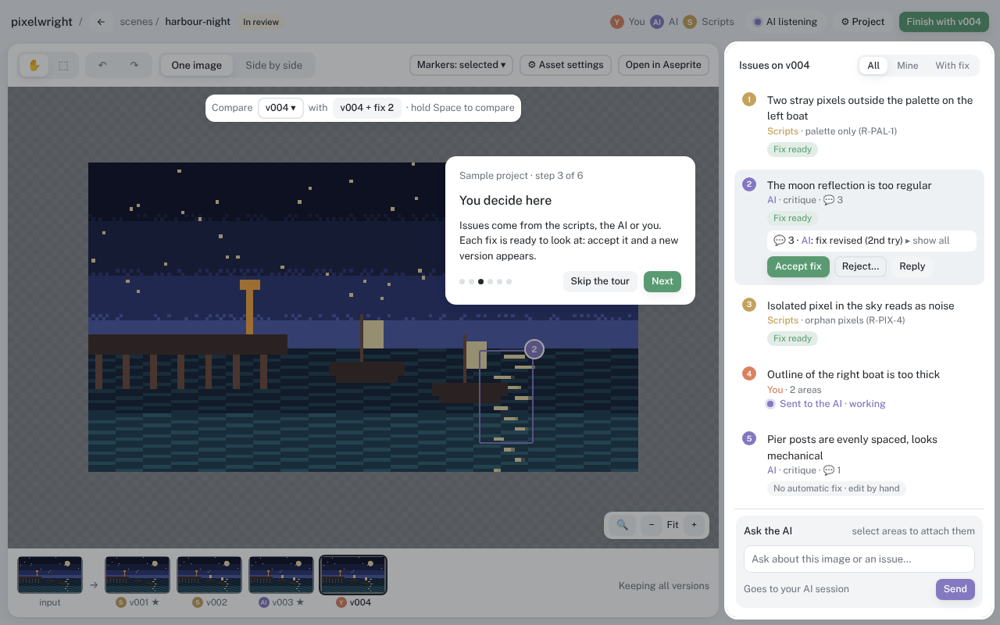
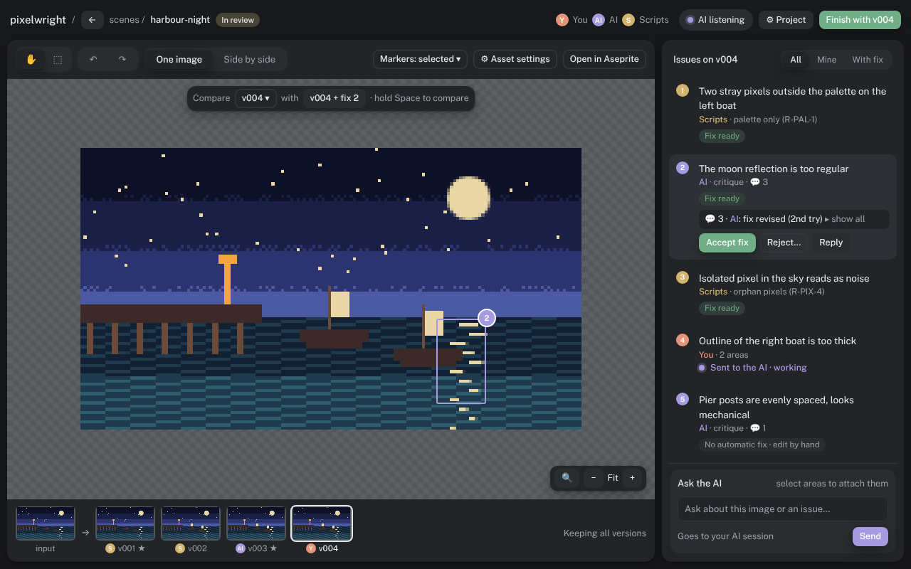

# pixelwright — app screens (M4)

**Revision**: 6
**Status**: draft
**Revision log**:
- r6 — applied `pixelwright-screens-v5-2026-11-17-0132-notes.md` (4 notes): "In the game" becomes **Finished** and the button **Finish with v004** (not every project is a game); the back button is an arrow plus the path `scenes / harbour-night`; groups are called **categories**, and adding images asks for the category (with "+ New category…"), which sets size, palette and checks; Undo and Redo moved to the canvas toolbar; 🔍 zoom-to-area moved next to the zoom controls, away from the Move/Select switch.
- r5 — applied `pixelwright-screens-v4-2026-11-17-0045-notes.md` (10 notes): AI colour violet (apart from the green of done); ⋯ after the group count; "Use v004 in the game" replaces Approve, state "In the game"; Undo; Asset settings label; one-line conversation summary; compare hint beside the compare bar; "select areas to attach them"; Mark fixed for fixes made outside the app; + New type; zoom rectangle keeps the canvas shape
- r4 — applied `pixelwright-screens-v3-2026-11-16-2216-notes.md` (6 notes) and the remaining `pixelwright-screens-v1-2026-11-16-1955-notes.md` (5 notes): everything in the folder is picked up and processed (states Processing / In review / Approved); filters all on the left; add dialog with asset type and custom types; Review all new with AI; compare bar (choose what to compare); zoom tool; side by side fills each half; Ask the AI always available, areas optional; Approve moved to the top bar as "Approve and copy to game"; reply counts; ★ Keep explained; softer colours, transparency checkerboard behind the art
- r3 — applied `pixelwright-screens-v2-2026-11-16-1820-notes.md` (6 notes): "advice" replaced by issues with ready-to-see fixes; Move / Select tool switch; multi-area selection with ×; new-issue composer; markers on demand; hold to compare; accept several fixes at once; replies on a fix; lighter font; states Not started / In progress / Approved; folder watching; project = folder with pixelwright.toml
- r2 — applied `pixelwright-screens-v1-2026-11-16-1748-notes.md` (8 notes + thread question): no logo yet, shorter start screen, Open… takes a folder or any image in a project, author legend and author names, request box says where it goes, fit/zoom/pan with linked before/after, Mark an area moved into the request box, group ⋯ and Asset settings for overrides, sort order, advice history

The screens of the new app (spec §2.2, plan T52), drawn as a static mockup (`status/screens/mockup.html`,
`#s01` … `#s10`, add `,dark` for dark mode) before anything is built. The art is a placeholder.

## S00 · Ground rules for every screen

- **Two places only**: a project (its assets) and one asset. Settings and the start screen sit outside the flow.
- **Who is next is always visible.** Every asset says its next step and who does it: you (orange), the AI (teal) or the scripts (amber). Issues, versions and markers use the same three colours.
- **The AI status is always in the top bar**: "AI listening" when a session is waiting with `pw wait`, otherwise "No AI session: requests wait".
- **Words.** An **issue** is something wrong or improvable in one or more areas, raised by the scripts, the AI or you. A **fix** is a proposed solution to an issue, always computed as a candidate image you can look at before deciding. You accept a fix (it becomes the next version), reject it (with a reason) or reply (the AI revises it). An issue nobody can fix automatically says so and offers Aseprite.
- **Tools**, as a switch: ✋ Move (drag pans) and ⬚ Select (drag marks areas; other markers hide meanwhile). **🔍 Zoom to an area** lives apart, with the zoom controls at the bottom right: drag a rectangle with the canvas shape.
- **Versions move forward one fix at a time.** Accepting a fix (or several together) writes the next version: v003 + fix → v004. Nothing is overwritten, and **↶ Undo / ↷ Redo** in the canvas toolbar (Ctrl+Z / Ctrl+Shift+Z) step back and forth: an accepted fix returns to pending and the previous version is current again.
- **"Finish with v004"** marks that version as the asset's final image and copies it to the export folder; the asset shows **Finished**. New issues or fixes later make a v005, which you can finish again.
- **Fixes outside the app**: Open in Aseprite opens the current version; saving there adds a new version here (the folder is watched). The issue then offers **Mark fixed**.
- **Authors are named, not only coloured**: a legend in the top bar, and each issue starts with Scripts, AI or You.
- **The logo is a placeholder** (wordmark only) until the logo task.
- Pixels only in the image; soft chrome; light and dark themes.

## S01 · Start

Shown when no project is open: one sentence and three ways in. Opening an image that lives inside a project opens that project at that image's asset. **A project is a folder that holds a `pixelwright.toml`**; there is no separate project file. Opening that file (double-click once the app is installed), the folder, or any image inside it opens the project. The sample project starts the guided first run.

## S02 · Project

All the assets of a project, by group (sub-folders). Each card shows its state and its single next step with the actor. "Waiting on" counts what each actor owes. **Everything in the project folder is picked up**, whether dropped here or saved there by another program, and the scripts clean and check it straight away. **States**: Processing (scripts running), In review, Approved. The AI only reviews when asked: per asset, or **Review all new with AI** for every asset it has not seen. All filters live on the left (Waiting on, State, Groups); a group's ⋯ (on hover) sets its defaults. **Order**: assets waiting on you first, then by last change; the Sort menu also offers name. A group's ⋯ menu sets its defaults (canvas size, palette).

## S03 · Asset: looking at a fix

**Finish with v004** sits in the top bar: it makes v004 the final image and copies it, with its final name and format, to the export folder set in the project settings. The **Compare** bar says what is on screen: the left side is a menu (any version or the input), the right side is the selected fix(es). **Ask the AI** is always at the bottom of the panel; marking areas is optional. 💬 shows how many replies an issue has; the selected issue shows the last message in one line, and "show all" expands the conversation (S12). ⚙ Asset settings holds the asset's type, size, palettes and brief. Issues on the right, pending first; done ones fold into Done. Clicking an issue shows **the image with its fix applied** and only that issue's marker (Markers: all / selected / none). Hold Space, or press and hold on the image, to see the current version, then let go. Accept fix, Reject… or Reply. With no areas selected, the panel says how to raise an issue.

## S04 · Rejecting a fix

Reject asks why. The reason can become a style rule for this asset, its group or the whole project, so the same issue is not raised again.

## S05 · Raising an issue

With ⬚ Select, drag marks an area and Ctrl+drag adds more; each area has a × and Esc clears them all. The panel then shows **New issue on 2 areas** with a text box: it is always clear that you are creating an issue. Send hands it to the AI session (the conversation itself stays in Claude Code or Desktop). Issue 4 shows one sent earlier, which the AI is working on; its fix appears like any other.

## S06 · Side by side

Each side takes half the canvas and zooms in; zoom and drag are linked, so both sides show the same area. The left label is a menu to pick what to compare with.

## S07 · Project settings

Palette library (groups set a default), default canvas, export path (can point into the game engine's project), "Keep all versions" (on by default), and the style rules, including the ones learnt from rejections. **★ Keep** marks a version to keep even when "Keep all versions" is off. The canvas here is the project default; a group overrides it from its ⋯ menu and an asset from ⓘ Asset settings.

## S11 · Several fixes at once

Ctrl+click several issues: the image shows all their fixes applied together, and one button accepts them as a single new version.

## S12 · Replying on a fix

Reply keeps a short conversation on the issue; the AI answers by revising its fix, and the newest try is what the image shows.

## S14 · Adding images

Dropping one or more images asks for the category once (the left panel's scenes, characters, props…), proposed from where you dropped them; "+ New category…" creates one. Each category sets its canvas size, palette and checks in the project file.

## S15 · Zoom to an area

The 🔍 tool: drag a rectangle and the view zooms into it.

## S08 · First run, step 1

The sample project opens with a short guide (6 steps) that points at the real screen instead of a help page.

## S09 · First run, step 2

## S10 · First run, step 3

## S13 · Dark theme

