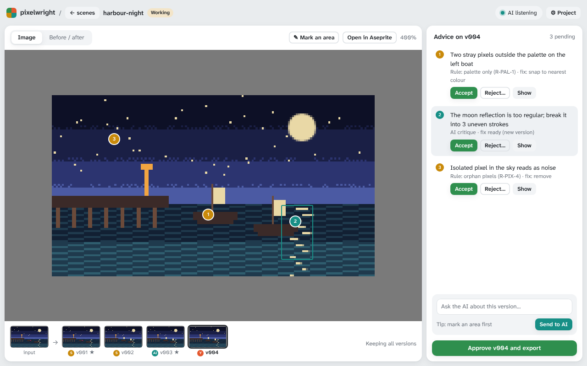
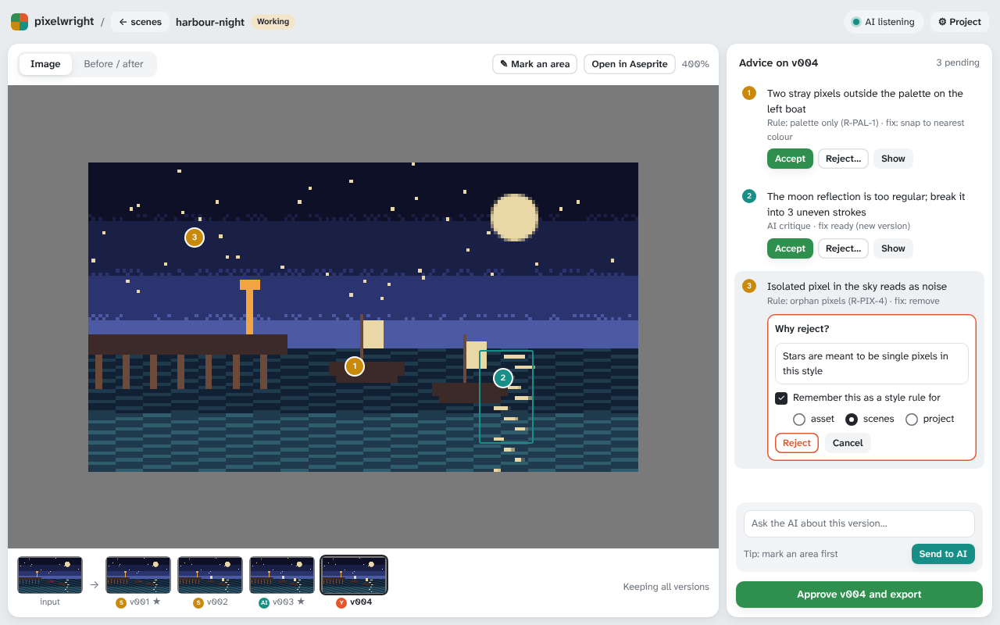
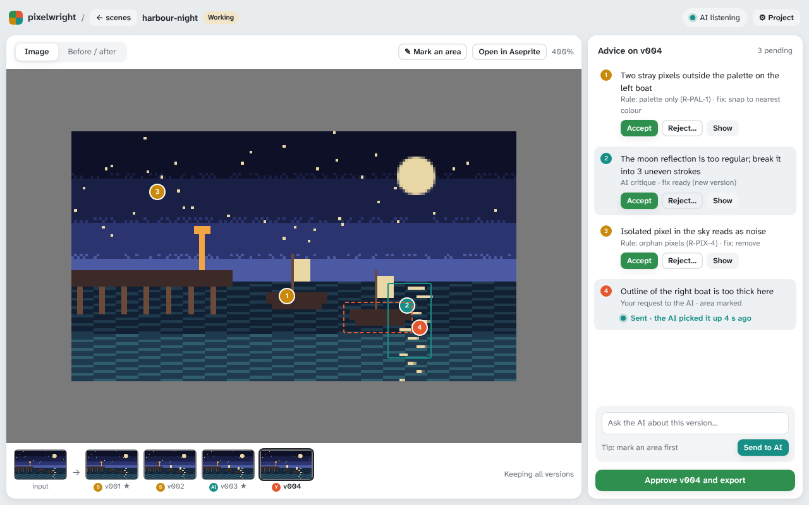
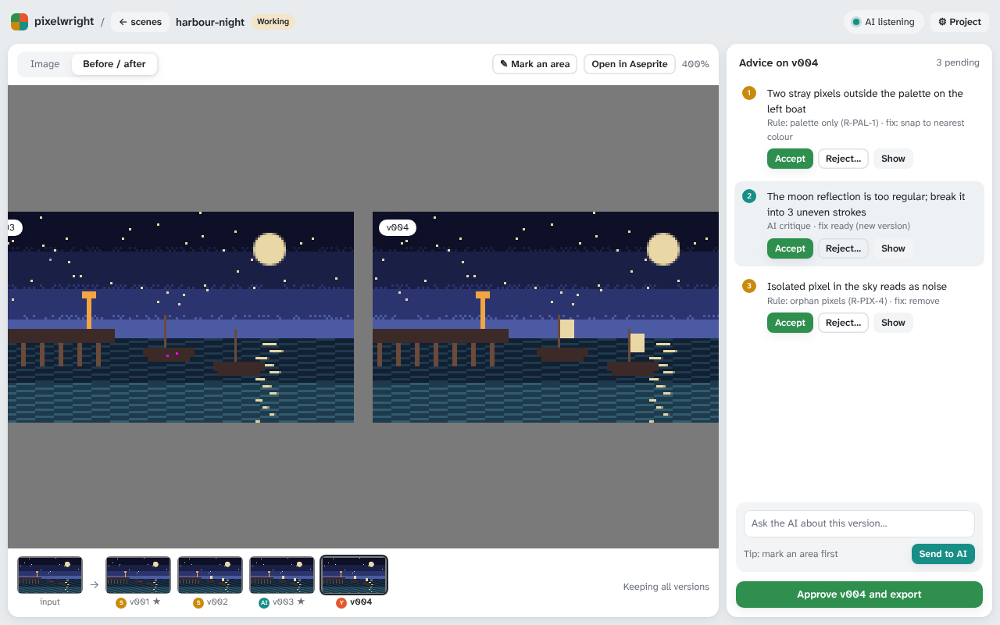
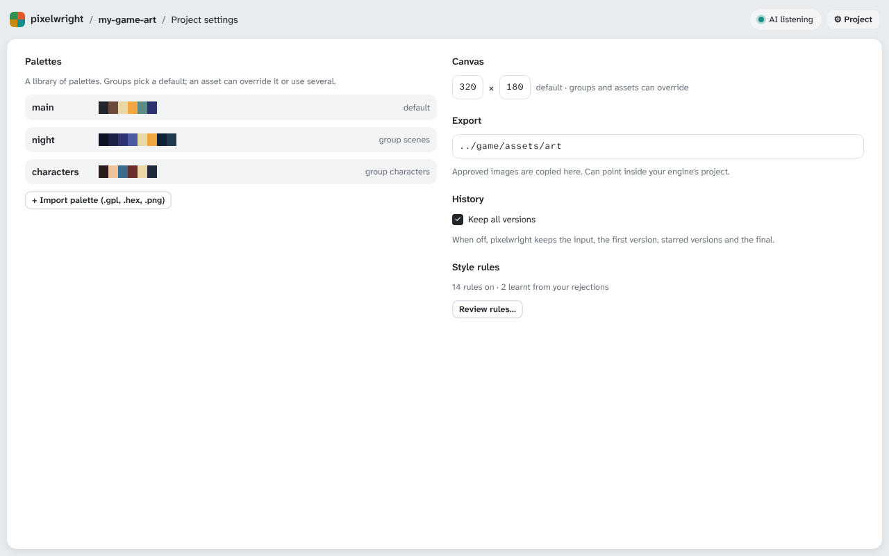
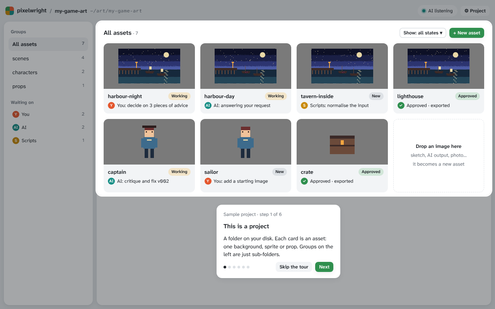

# pixelwright — app screens (M4)

**Revision**: 1
**Status**: draft

The screens of the new app (spec §2.2, plan T52), drawn as a static mockup (`status/screens/mockup.html`,
`#s01` … `#s10`, add `,dark` for dark mode) before anything is built. The art is a placeholder.

## S00 · Ground rules for every screen

- **Two places only**: a project (its assets) and one asset. Settings and the start screen sit outside the flow.
- **Who is next is always visible.** Every asset says its next step and who does it: you (orange), the AI (teal) or the scripts (amber). Advice, versions and markers use the same three colours.
- **The AI status is always in the top bar**: "AI listening" when a session is waiting with `pw wait`, otherwise "No AI session: requests wait".
- **No modes.** The asset screen has one view of the image, with a Before / after switch; marking an area is a button, not a mode.
- Pixels only in the image; soft chrome; light and dark themes.

## S01 · Start

Shown when no project is open. One sentence says what the tool does, one line shows the flow, and there are three ways in. The sample project starts the guided first run.

## S02 · Project

All the assets of a project, by group (sub-folders). Each card shows its state and its single next step with the actor. "Waiting on" counts what each actor owes. Dropping an image anywhere creates an asset (flow step 1).

## S03 · Asset

The image in the centre with numbered advice markers; the versions strip below (input → v001 …, author of each, ★ = starred); advice on the right with Accept / Reject… / Show. Below it: ask the AI, and the one final action, Approve and export (step 6).

## S04 · Rejecting advice

Reject asks why. The reason can become a style rule for this asset, its group or the whole project, so the same advice is not given again.

## S05 · A request to the AI

You mark an area (dashed) and ask. The request appears in the advice list; its status shows when the AI picked it up. The AI answers with new advice or a new version.

## S06 · Before / after

The previous and the current version side by side, at the same zoom.

## S07 · Project settings

Palette library (groups set a default), default canvas, export path (can point into the game engine's project), "Keep all versions" (on by default), and the style rules, including the ones learnt from rejections.

## S08 · First run, step 1

The sample project opens with a short guide (6 steps) that points at the real screen instead of a help page.

## S09 · First run, step 2

## S10 · First run, step 3

## S11 · Dark theme

