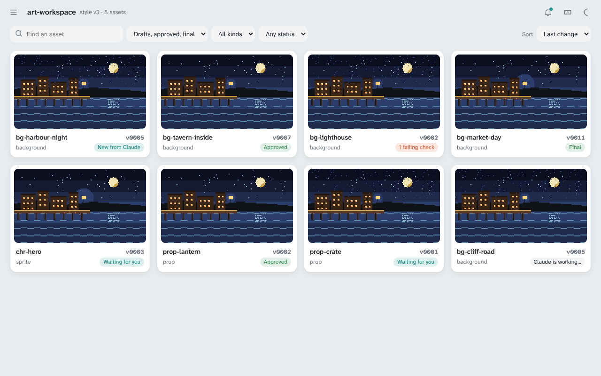
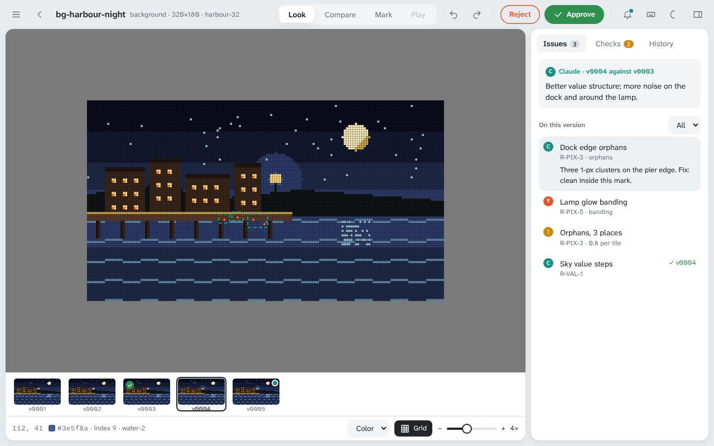
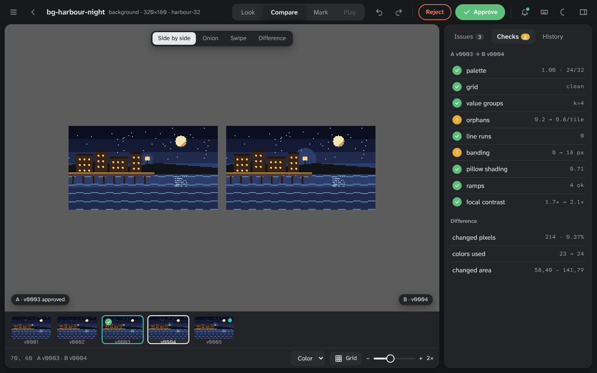
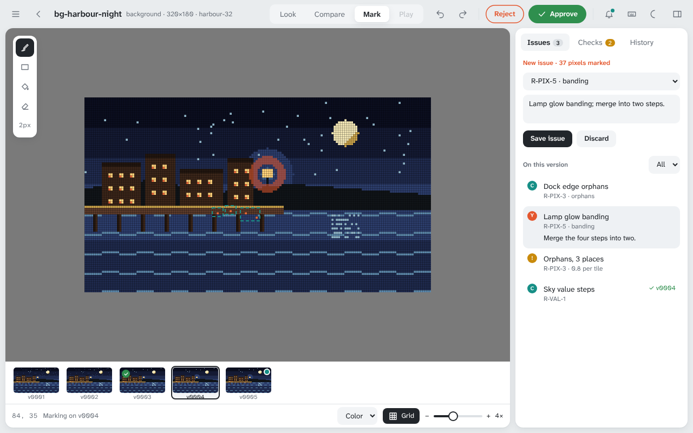
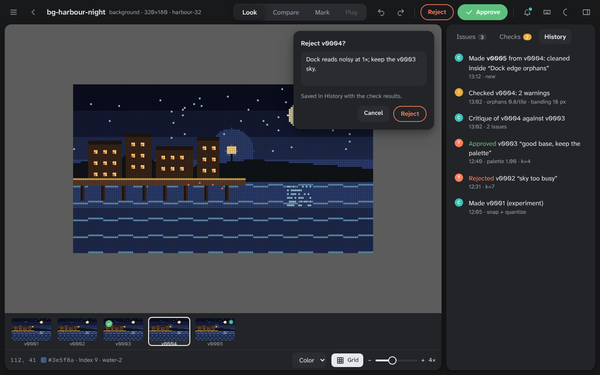
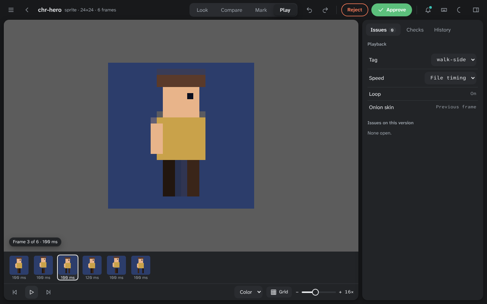

# pixelwright — Screens (annotated edition)

> Generated 2026-11-15. This is the document with a **note slot** after every section that has text of its own. Read it in any Markdown app. To annotate, replace the `_(your notes…)_` placeholder under any section. When done, send the file back — notes are acted on.

---

# Screens

## Preamble & scope

**Revision**: 3

The screens of `pw view` (spec §2.8), drawn as a static mockup (`status/viewer/mockup.html`,
`#s02` light, `#s02,dark` dark) before anything is built. The art is a placeholder scene.

<!-- -->

> **✎ Notes** · `SCREENS · intro`
> _(your notes here — replace this line)_

## S00 · Ground rules for every screen

What holds on all screens, so each screen below only says what is specific to it.

- **The image is the centre.** Two places only: the asset list, and one asset. Inside an
  asset, four modes on one centred switch: Look, Compare, Mark, Play (Play only when the
  version has frames). Everything else sits at the edges and the side panel hides (Tab).
- **Everything where expected.** Top: where you are (back to the list, asset name), the
  mode, undo/redo, and the decision (Reject, Approve). Bottom: the versions, then a status
  bar with the pixel under the cursor on the left and how you look at it on the right
  (view, grid, zoom slider). Right: what is known about this version (Issues, Checks,
  History).
- **Every control is a visible control** (button, select, slider), never plain text that
  happens to be clickable. Each shows its name and shortcut on hover; no key labels
  printed on screen. All of it works from the keyboard.
- **Nothing vanishes.** No toasts. A new version from Claude gets a dot on its thumbnail
  until seen; a running step shows on the asset card; everything lands in History.
- **One way to undo.** Ctrl+Z undoes the last mask stroke or saved issue, and a decision
  (logged as a reversal, since the history is append-only). Same everywhere.
- **Light and dark.** Follows the system; one button switches. Soft chrome, pixels only in
  the image: cool mineral gray in light, soft graphite in dark; rounded panels and pill
  buttons, line icons, gentle shadows. Type: Atkinson Hyperlegible Next for text and its
  Mono for numbers (both OFL, shipped inside the package so the viewer works offline).
- **One place for news.** The inbox bell (top right) collects what happened while you were
  away (new versions, finished checks, Claude's critiques), with a dot until seen. The
  keyboard icon beside it lists the shortcuts of the current screen; the menu icon (top
  left) holds every command, so nothing needs a toolbar.
- **Colors are never judged on a tinted ground.** The canvas is neutral gray in both
  themes; checkerboard behind transparent pixels; integer zoom; grid from 4x.
- **Author colors are the same everywhere**: coral = you, teal = Claude,
  ochre = a check. Status uses a shape and a color (✓ ! ✕), not color alone.
- Technical: one local page served by `pw view` on 127.0.0.1 (stdlib HTTP server, plain
  HTML/CSS/JS in the package, no build step); polls the workspace every 2 s; writes only
  masks and history through the core functions, never pixels; refuses non-local clients
  and foreign `Host` headers; writes need a per-run token. The URL holds asset, version
  and mode, so `pw view --open bg-harbour-night/v0004` lands on the right screen.

<!-- -->

> **✎ Notes** · `SCREENS › S00 · Ground rules for every screen`
> _(your notes here — replace this line)_

## S01 · Asset list

Every asset as a card: its newest version and the one thing it is waiting on.

- One status line per card, in words: waiting for you, new from Claude, 1 failing check,
  Claude is working, approved, final.
- Filters are plain selects: stage (drafts, approved, final by default), kind, status;
  find by name; sort by last change. No panels: all the room is for cards.
- Click a card: the asset opens in Look on its newest version.

<!-- -->

> **✎ Notes** · `SCREENS › S01 · Asset list`
> _(your notes here — replace this line)_

## S02 · Look

One version, its issues and the decision.

1. Issues panel: Claude's verdict for this version on top (one line from `critique.md`),
   then every issue on this version, whoever raised it. Click an issue: its region is
   outlined on the image and the note opens.
2. Versions at the bottom: thumbnail, approved tick, a dot for unseen new ones. Arrows
   move between them.
3. Status bar: pixel under the cursor (position, swatch, palette index, hex, ramp), the
   version's stage and parent; then view (Color, Gray, Values, Silhouette, 25% thumb),
   grid and zoom.
4. Approve and Reject sit top right; both are always one click away.

<!-- -->

> **✎ Notes** · `SCREENS › S02 · Look`
> _(your notes here — replace this line)_

## S03 · Compare

Two versions, to judge whether the new one is better than the previous best (`R-CRIT-2`).

- A is the latest approved version (dashed thumbnail), B the selected one; click a
  thumbnail for B, shift-click for A.
- Side by side (zoom and pan synced), Onion, Swipe, Difference, on a small switch over the
  canvas.
- The Checks tab shows each check A → B, then the difference: changed pixels, colors
  used, area changed.

<!-- -->

> **✎ Notes** · `SCREENS › S03 · Compare`
> _(your notes here — replace this line)_

## S04 · Mark

Marking a complaint on the image, in native pixels, so a fix can run only there
(`R-CRIT-3`).

- A small tool column appears on the canvas only in this mode: brush, rectangle, fill
  (same color, contiguous), erase, brush size.
- The new issue form takes the top of the Issues panel: rule (check catalog rule ids, or
  other), note, Save or Discard. Existing issues stay visible below.
- An issue is one thing for everyone: a region (mask), a rule, a note, an author, and a
  status (open, or fixed in a version). Claude's critique complaints and check regions
  are issues too, so there is one list, not three.
- Contract change: `masks.yaml` entries gain `version` and `status`; the schema bumps and
  old entries read as open. `critique.md` gets front matter (`version`, `compared_to`,
  `verdict`) and one `##` per complaint naming its mask.

<!-- -->

> **✎ Notes** · `SCREENS › S04 · Mark`
> _(your notes here — replace this line)_

## S05 · Decide and History

Rejecting a version, and the asset's log (dark theme).

- Reject asks why (required); Approve takes an optional note. Both are logged with the
  check measurements (`R-CRIT-4`). Esc cancels.
- History, newest first: versions made, checks, critiques, decisions and notes, with the
  author's color and the key numbers.

<!-- -->

> **✎ Notes** · `SCREENS › S05 · Decide and History`
> _(your notes here — replace this line)_

## S06 · Play

Playing the frames of a `.aseprite` version with its own timing (dark theme). Rigs,
templates and cross-frame checks are M4; in M2 this is a player.

- Frames replace the versions strip; play, previous and next frame sit in the status bar.
- The side panel shows tag, speed, loop and onion skin, and the issues on this version.

<!-- -->

> **✎ Notes** · `SCREENS › S06 · Play`
> _(your notes here — replace this line)_

## S07 · Not in M2

Screens the spec lists that wait for their milestone.

- Scene preview (a character moving through a background, parallax): M4, with `pw scene`.
- Light zones editor: M4, with `pw light`.
- Provider and cost views: M3, with `generate`.

<!-- -->

> **✎ Notes** · `SCREENS › S07 · Not in M2`
> _(your notes here — replace this line)_

## What changed in revision 3

- New look: no cream or paper tones and no hard pixel-style edges in the chrome; soft
  gray surfaces, rounded panels, pill buttons, line icons, a friendlier typeface.
- Inbox bell, shortcuts icon and menu icon added (one place for notices, contextual keys).
- Authors shown as small colored avatars (Y, C, !) in Issues and History.

<!-- -->

> **✎ Notes** · `SCREENS › What changed in revision 3`
> _(your notes here — replace this line)_

## What changed in revision 2

- Six tabs became two places (list, asset) and four modes; Critique merged into Issues and
  History; mask list, critique complaints and check regions became one Issues list.
- Approve and Reject moved to the top bar; versions moved to the bottom.
- Light theme added and made the default when the system is light; own look instead of a
  generic dark dashboard.
- Printed shortcuts removed (hover shows them); clickable things look clickable; no
  transient notices.

<!-- -->

> **✎ Notes** · `SCREENS › What changed in revision 2`
> _(your notes here — replace this line)_

