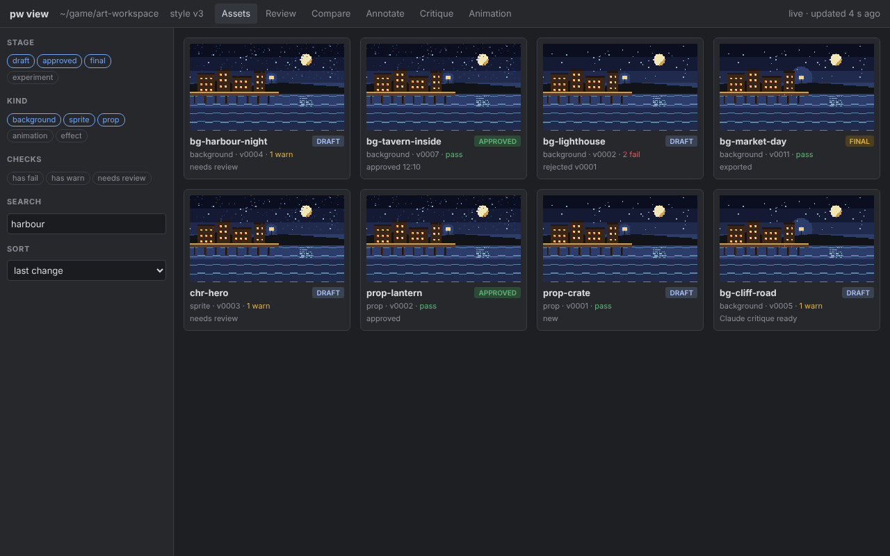
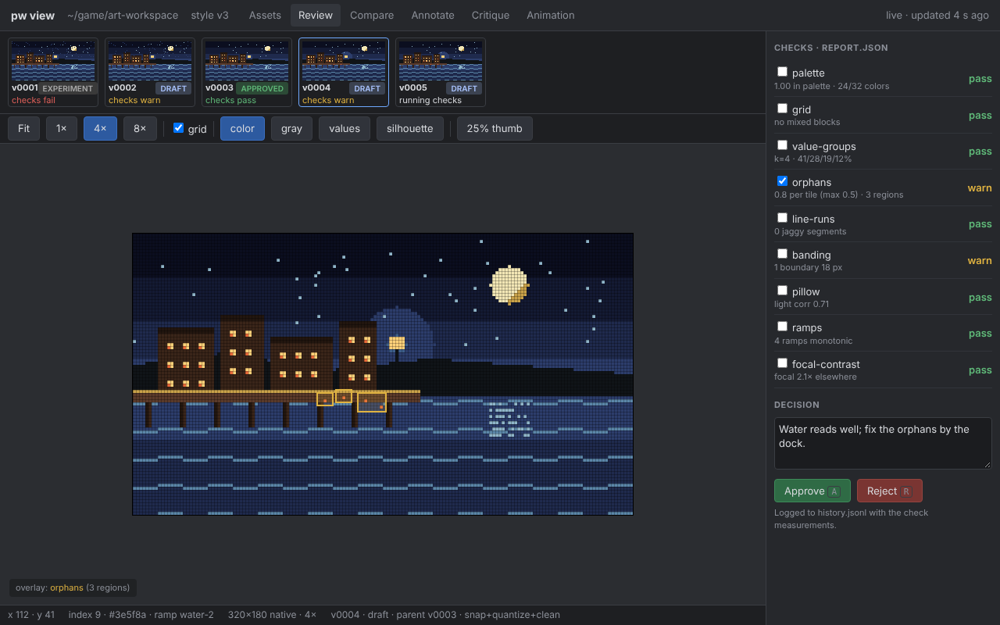
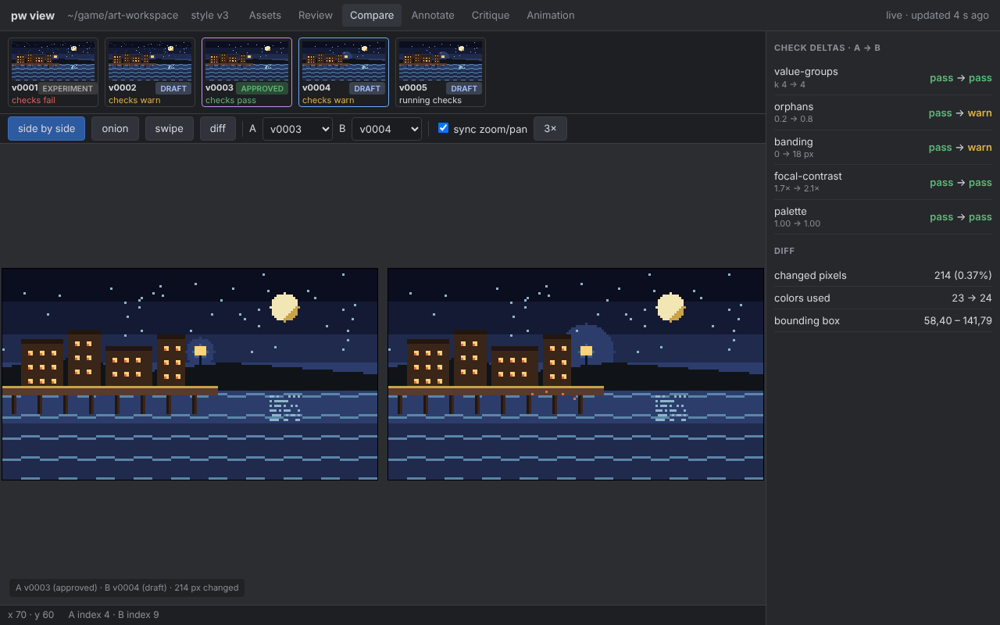
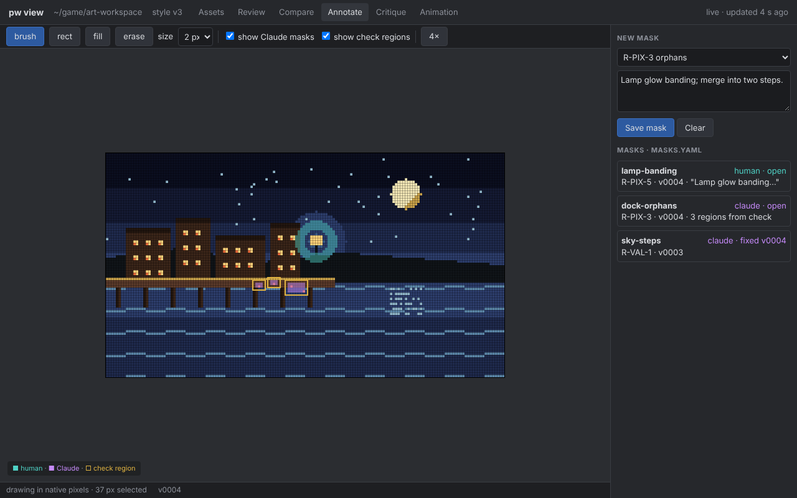
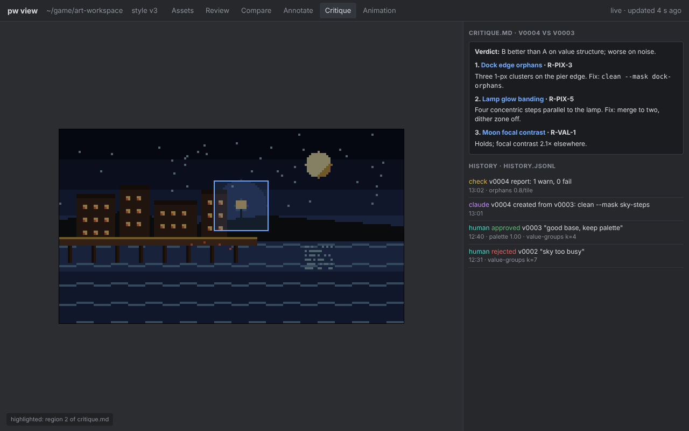
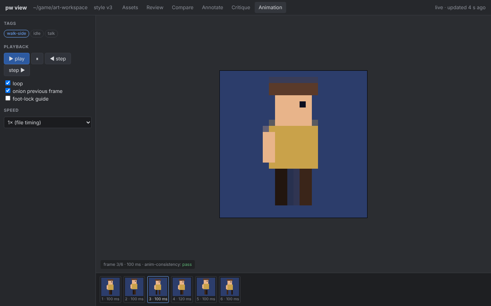

# pixelwright — viewer screens (M2)

**Revision**: 1

The screens of `pw view` (spec §2.8), drawn as a static mockup (`status/viewer/mockup.html`)
before anything is built. The art in the shots is a placeholder scene drawn by the mockup.

## S00 · Ground rules for every screen

What holds on all screens, so each screen below only says what is specific to it.

- One local page served by `pw view` on 127.0.0.1 (stdlib HTTP server, plain HTML/CSS/JS
  shipped in the package, no build step, no UI framework).
- Tabs: Assets, Review, Compare, Annotate, Critique, Animation. The URL holds asset,
  version and tab, so a link from Claude (`pw view --open bg-harbour-night/v0004`) opens
  the right screen.
- Neutral gray canvas background (no tint on judged colors); checkerboard behind
  transparent pixels; integer zoom only; pixel grid from 4x.
- Live: the page polls the workspace every 2 s, so a version Claude writes appears
  without a reload ("updated 4 s ago" in the header).
- The viewer writes only masks (`masks/`) and decisions/notes (`history.jsonl`), through
  the same core functions as the CLI. It never edits pixels.
- Security: refuses non-local clients and foreign `Host` headers; every write needs a
  per-run token embedded in the page.

## S01 · Asset list

The start screen: every asset in the workspace as a card with its latest version, stage,
check summary and what it is waiting on.

- Filters: stage (draft, approved, final on by default; experiment off), kind, check
  status (has fail, has warn, needs review), text search; sort by last change.
- "Needs review" means: newest version has no human decision yet.
- Click a card: opens Review on the newest version.

## S02 · Version review

The main working screen: one version at a time, its checks, and the approve/reject
decision.

1. Timeline of versions with thumbnail, stage badge and check summary; click to switch.
2. Zoom (fit, 1x, 2x, 4x, 8x, 16x), grid toggle, render modes from `render`: color,
   gray, values, silhouette, and a 25% thumbnail (readability).
3. Checks panel from `report.json`: each check with status and measurement; ticking a
   check draws its regions on the image.
4. Status bar: native coordinates, palette index, hex and ramp under the cursor; size,
   stage, parent and the steps that made the version.
5. Decision: note plus Approve (A) or Reject (R). Reject needs a note. The decision is
   logged with the check measurements (`R-CRIT-4`).
6. Keyboard: arrows switch versions, 1-5 zoom, G grid, A/R decide.

## S03 · Compare

Two versions of the same asset, to judge whether a new version is better than the
previous best (`R-CRIT-2`: pairwise, never a bare score).

- Modes: side by side (pan and zoom synced), onion skin (opacity slider), swipe, diff
  (changed pixels highlighted, everything else dimmed).
- A defaults to the latest approved version, B to the selected one.
- Right panel: check deltas A → B, changed pixel count and share, colors used,
  bounding box of the change.

## S04 · Annotate

Drawing a complaint as a mask in native pixels, with a rule id and a note, so a fix can
run inside it (`R-CRIT-3`).

- Tools: brush (1-4 px), rectangle, fill (same palette index, contiguous), erase.
- Layers shown: human masks, Claude masks, check regions (outline only); each toggles.
- New mask: rule picker (check catalog rule ids plus "other"), note, Save. Saved masks go
  to `masks/<id>.png` and `masks.yaml` via `Asset.add_mask`.
- Mask list: id, author, rule, version it was drawn on, status open or fixed.
- Contract change: mask entries gain `version` and `status` (`open` | `fixed`, with the
  fixing version). The schema bumps; old entries read as `open`, version unknown.

## S05 · Critique and history

Claude's critique of a version beside the image, and the asset's log.

- `critique.md` rendered; each numbered complaint links to its region (mask or box),
  which is highlighted on the image when clicked.
- Critique format (new in M2): front matter with `version`, `compared_to`, `verdict`;
  one `##` per complaint with rule id, region (mask id or box), proposed fix.
- History from `history.jsonl`, newest first: steps, check runs, decisions with their
  measurements, notes; author colored (human, Claude, check).

## S06 · Animation preview

Playing the frames of a `.aseprite` version with its own timing. Built in M2 only as a
player; rigs, templates and cross-frame checks are M4.

- Tag picker (from the file's tags), play/pause, step, loop, speed (0.5x, 1x, 2x; default
  the file timing).
- Onion skin of the previous frame; frame strip with per-frame duration.
- `anim-consistency` status appears once that check exists (M4).

## S07 · Not in M2

Screens the spec lists that wait for their milestone, so they are not drawn yet.

- Scene preview (character moving through a background, parallax): M4, with `pw scene`.
- Light zones editor: M4, with `pw light`.
- Provider and cost views: M3, with `generate`.
